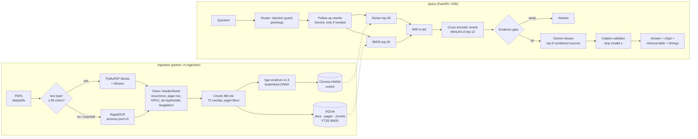

# Granth — Open-Source PDF Knowledge Assistant

Granth answers questions over a library of large PDFs, including scanned ones. Every answer cites the
**file and page** it came from, and you can open the page image with the source passage highlighted.
Everything runs locally on a laptop CPU. Gemini is the only hosted component; it generates the answer text.

- **Ingestion:** PDF → native text (PyMuPDF) or OCR (RapidOCR) → cleaning → 480-token chunks → embeddings →
  Chroma (HNSW) + SQLite FTS5
- **Retrieval:** dense top-30 + BM25 top-30 → Reciprocal Rank Fusion → cross-encoder rerank → top-6 to the LLM
- **Generation:** streamed (SSE) answer with `[n]` citations. Invalid citations are stripped. The system abstains
  when the evidence is weak.
- **UI:** chat with citation chips and page previews, a retrieval panel with every stage's scores, an ingestion
  dashboard, and evaluation metrics.

## Measured results (i3-8130U, 4 threads, no GPU)

| Metric | Value |
|---|---|
| Recall@1 / @5 / @10 | 75% / 90% / 95% |
| MRR@10 | 0.821 |
| Citation accuracy | 100% (32 citations) |
| Hallucination rate (LLM judge, answers with ≥1 unsupported claim) | 0% (49 claims judged) |
| Correct abstention on unanswerable questions | 100% |
| False abstention on answerable questions | 10% |
| End-to-end latency p50 / p95 | 3.44 s / **4.07 s** |
| LLM time to first token (server) p50 / p95 | 0.98 s / 1.67 s |

Retrieval ablation on the same questions (R@1 / MRR@10): dense only 60% / 0.680, BM25 only 75% / 0.817, RRF 70% / 0.776, **RRF + rerank 75% / 0.821**.

How these were measured (`evaluation/report.md`):
- 25 questions: 20 answerable, generated by Gemini from sampled chunks with gold file + page and marked `reviewed: false` (not human-checked yet), plus 5 hand-written unanswerable questions.
- **The run searched a snapshot holding `biology-2e.pdf` only** (2,237 chunks). The other PDFs were still ingesting, and that ingestion shared the CPU during the run. The bottleneck stage is the reranker: p50 2.28 s under contention versus 0.76 s idle (`scripts/bench_models.py`).
- Latency is client-measured over SSE, sequential, after one warm-up query. Gemini time to first token is about 1 s.
- The abstention threshold (0.002 on the reranker's sigmoid score) was picked from the threshold sweep in the report. Unanswerable questions scored ≈0.0000; the lowest-scoring answerable question scored 0.003. Both remaining false abstentions came from the LLM declining despite the gold chunk being retrieved, not from the gate.

## Architecture



## Design decisions

| Area | Choice | Why |
|---|---|---|
| Vector DB | ChromaDB `PersistentClient`, HNSW, cosine | Embedded, no server or Docker, persists to `data/chroma` |
| Lexical search | SQLite FTS5 (BM25, porter stemmer) | Python stdlib; catches exact terms (names, formulas) that dense search misses |
| Fusion | RRF, k=60 | Parameter-free and robust to the different score scales of cosine and BM25 |
| Embeddings | `BAAI/bge-small-en-v1.5` (384-d) via fastembed ONNX | Open source, strong for its size, fast enough on a 2-core CPU; separate query/passage modes |
| Chunking | ~480 tokens (hard cap 510), 72-token (15%) sentence-aligned overlap, measured with the embedder's own tokenizer | The challenge asks for 500–1000 tokens. bge-small's window is **512 tokens**, so anything longer would be silently truncated before embedding. We sit at the lower bound to stay inside the window. |
| Reranker | `ms-marco-MiniLM-L-6-v2` cross-encoder (ONNX), top-12 candidates, 256-token truncation, toggle `RERANKER_ENABLED` | Benchmarked on the i3: 20 pairs × 512 tokens = 4.2 s, 12 × 256 = 0.76 s (`scripts/bench_models.py`) |
| OCR | `rapidocr-onnxruntime` (pip only); Tesseract used only if `OCR_BACKEND=tesseract` and it is on PATH | No system install; PP-OCR models are accurate on old scans (mean confidence 0.93–0.98 in our runs) |
| LLM | Gemini (`google-genai`): fast tier for answers, heavy tier for eval-set generation and judging | Hosted LLMs are allowed; streaming plus a 512-token output cap keeps latency down. Keys rotate on 429; each tier falls back to a second model. |
| Language | `langdetect`, seeded | Deterministic per-page language tag |
| Storage | Everything under `./data/` (gitignored) | Fully local and reproducible |

## Setup (Windows, Python 3.12, no GPU, no system packages)

```powershell
git clone <repo> granth; cd granth
py -3.12 -m venv .venv
.venv\Scripts\python -m pip install -r requirements.txt
copy .env.example .env        # then set GEMINI_API_KEY (optionally _2, _3)
cd frontend; npm install; cd ..
```

## Run

```powershell
# 1. Corpus: 10 OpenStax textbooks + 2 public-domain scans -> data\pdfs (about 1.3 GB)
.venv\Scripts\python scripts\download_corpus.py

# 2. Ingest (resumable, idempotent by sha256; re-running skips finished PDFs)
.venv\Scripts\python -m ingestion            # --status to print the table, --only <name>, --force

# 3. API (loads and warms all models at startup) and UI
.venv\Scripts\python -m uvicorn app.main:app --app-dir backend --port 7860
cd frontend; npm run dev                      # http://localhost:5173

# 4. Tests, branding check, evaluation
.venv\Scripts\python -m pytest backend\tests -q
.venv\Scripts\python scripts\check_branding.py
.venv\Scripts\python -m evaluation.build_eval_set   # writes evaluation\eval_set.jsonl (reviewed=false)
.venv\Scripts\python -m evaluation.runner           # needs the API running; writes evaluation\report.md/.json
.venv\Scripts\python scripts\bench_models.py        # embedding / reranker speed on this machine
```

API: `POST /api/v1/query` (SSE: `status`, `rewrite`, `retrieval`, `token`, `final`, `done`),
`GET /api/v1/documents`, `GET /api/v1/documents/{id}/page/{n}/image`, `GET /api/v1/ingestion/status`,
`GET /api/v1/evaluation/report`, `GET /api/v1/health`. OpenAPI docs are at `http://localhost:7860/docs`.

## Corpus

12 PDFs, 9,981 pages, every PDF ≥ 266 pages (`corpus.yaml`, fetched by `scripts/download_corpus.py`). Attribution is written to `data/ATTRIBUTION.md` at download time. The OpenStax CMS API reports these books as **CC BY-NC-SA 4.0** (not CC BY), and that is what we record. The PDFs are not redistributed with the repo.

| File | Pages | Source / license | Ingestion |
|---|---|---|---|
| `biology-2e.pdf` | 1475 | OpenStax, CC BY-NC-SA 4.0 | native text; image-only pages OCR'd |
| `chemistry-2e.pdf` | 1203 | OpenStax, CC BY-NC-SA 4.0 | native text; image-only pages OCR'd |
| `university-physics-vol1.pdf` | 959 | OpenStax, CC BY-NC-SA 4.0 | native text; image-only pages OCR'd |
| `university-physics-vol2.pdf` | 781 | OpenStax, CC BY-NC-SA 4.0 | native text; image-only pages OCR'd |
| `university-physics-vol3.pdf` | 597 | OpenStax, CC BY-NC-SA 4.0 | native text; image-only pages OCR'd |
| `psychology-2e.pdf` | 755 | OpenStax, CC BY-NC-SA 4.0 | native text; image-only pages OCR'd |
| `principles-of-economics-3e.pdf` | 995 | OpenStax, CC BY-NC-SA 4.0 | native text; image-only pages OCR'd |
| `introduction-to-sociology-3e.pdf` | 664 | OpenStax, CC BY-NC-SA 4.0 | native text; image-only pages OCR'd |
| `calculus-vol1.pdf` | 769 | OpenStax, CC BY-NC-SA 4.0 | native text; image-only pages OCR'd |
| `microbiology.pdf` | 1221 | OpenStax, CC BY-NC-SA 4.0 | native text; image-only pages OCR'd |
| `principle-of-relativity-1920_scanned.pdf` | 266 | Public domain | fully OCR'd (RapidOCR, existing text layer ignored) |
| `first-studies-of-plant-life-1901_scanned.pdf` | 296 | Public domain | archive.org text layer |

## Limitations

- **Hardware:** all numbers are from an Intel i3-8130U laptop (2 cores / 4 threads, 12 GB RAM, no GPU). Embedding runs at about 3 chunks/s, so the first ingestion of the ~10k-page corpus takes roughly 1–1.5 h. It is resumable and only runs once.
- **Chunk size:** chunks are ~480 tokens, the lower end of the 500–1000 range, because bge-small truncates at 512 tokens.
- **Reranker truncation:** the reranker reads only the first 256 tokens of each chunk to stay inside the latency budget. It is also the stage most sensitive to CPU contention.
- **OCR scope:** OCR on figures inside the textbooks is disabled (`OCR_IMAGES_PER_DOC=0`) to save time; only image-only pages and the 1920 scan are OCR'd. The 1901 scan uses archive.org's existing text layer.
- **OCR quality:** old scans with equations OCR imperfectly. Formulas lose their structure, while running text is good (mean line confidence ≈0.93–0.98).
- **Eval set:** small (25 questions), LLM-generated, not yet human-reviewed, and run on a one-book snapshot. Treat the numbers as indicative. Re-run `python -m evaluation.runner` against the full index for final figures.
- **Single-user demo:** Chroma's persistent client is not built for concurrent writers. Don't run ingestion and the API on the same `data/` directory at the same time.
- **Gemini dependency:** answers need a Gemini key, and free-tier quotas can run out. Retrieval, the retrieval panel and the page previews still work without it.

## Repository layout

```
ingestion/      extract.py · ocr.py · clean.py · chunker.py · embedder.py · store.py · vector_store.py · pipeline.py
backend/app/    main.py · api/v1/* · services/ (router, retriever, query_service, citation_validator, ...) · providers/
frontend/src/   App.tsx · components/ (AnswerPanel, RetrievalPanel, PageImageModal, IngestionTab, MetricsTab, ...)
evaluation/     build_eval_set.py · runner.py · judge.py · metrics.py · eval_set.jsonl · report.md/json
scripts/        download_corpus.py · bench_models.py · check_branding.py
corpus.yaml     the demo corpus definition
```
